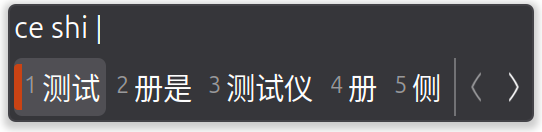
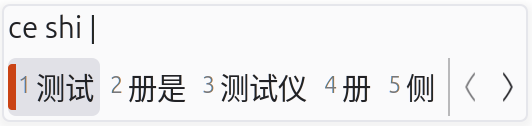

# Nord IBus Theme

[中文 Chinese](README_CN.md)

Extracted from [IBus Tweaker Stylesheet](https://github.com/tuberry/ibus-tweaker/blob/ce53de825cc61a4693eca66dc0445be3ddb789f6/res/style/stylesheet.scss).

## Example

**Dark**:

**Light**:

## Content

- [Simple Light](simple-light.css) #FAFAFB
- [Simple Dark](simple-dark.css) #36363A