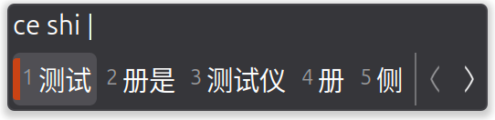
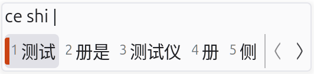

# 极简 IBus 主题

[English](README.md)

提取自[IBus Tweaker Stylesheet](https://github.com/tuberry/ibus-tweaker/blob/ce53de825cc61a4693eca66dc0445be3ddb789f6/res/style/stylesheet.scss)。

## 示例

**深色**:

**浅色**:

## 目录

- [极简白](simple-light.css) #FAFAFB
- [极简黑](simple-dark.css) #36363A
